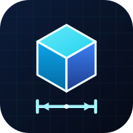

<div align="center">



# BuildMeasure Pro — القياس الهندسي الشامل

**تطبيق ويب هندسي (PWA) لقياس الأطوال والمساحات، مسح الغرف، قياس الأسطح والميول، حصر الكميات BOQ، وأدوات ميدانية — يعمل بدون إنترنت وتبقى بياناتك على جهازك.**

[](https://nidal-watfa99.github.io/BuildMeasurePro/)


</div>

---

## ✨ المميزات

### 📷 كاميرا القياس الذكية (واجهة كاملة الشاشة)
- **مؤشر رقمي** (دائرة تصويب مركزية) مرسوم فوق صورة الكاميرا مع **شريط/مسطرة** تتبع مسار القياس وتتحرك مع حركة الهاتف، وتعرض الوحدة تلقائياً (مم / سم / م).
  > الخط المعروض مؤشر رقمي فوق الصورة وليس شعاع ليزر حقيقياً.
- **قياس مثلثي حقيقي** باستخدام مستشعرات اتجاه الهاتف وارتفاعه عن الأرض:
  - **أرضي:** مسافات بين نقاط، طول مسار، **مساحة ومحيط** مضلع أرضي.
  - **جدار / ارتفاع:** يحدد مستوى الجدار من نقطة قاعدته ثم يقيس الارتفاعات والعروض (أبواب، نوافذ، جدران).
  - **يدوي بمعايرة مرجعية:** نقطتان قابلتان للسحب؛ لا يُعرض طول حقيقي قبل المعايرة (يُعرض بالبكسل).
- **الخطأ المتوقع (±)** بجوار كل قراءة، وتنبيه عند بعد الهدف، وتثبيت بمتوسط عدة إطارات لتقليل الاهتزاز.
- **معايرة الارتفاع بمسافة معلومة**، زاوية رؤية قابلة للضبط، حفظ القياس في المشروع، صورة توثيقية مع الخط والقيمة، مشاركة، مصباح، تبديل الكاميرا.

### 🧮 بقية الأدوات
مسح الغرف 2D/3D (تصدير **DXF** و**OBJ**) • قياس الأسطح المائلة • مسح الأجسام والأحجام • حصر الكميات **BOQ** (خرسانة، تشطيبات، حفر وردم) • مركز التحقق والمعايرة • **أدوات ميدانية:** ميزان رقمي، حاسبة الدرج، وزن حديد التسليح، حل المثلث القائم وفحص التعامد، تحويل الميل.

### 📤 التصدير والنسخ الاحتياطي
**PDF عربي** كامل • **Excel (XLSX) أصلي** • CSV آمن • DXF • OBJ • نسخة احتياطية JSON مع **تحقق قبل الاستعادة** ونسخة تلقائية قبل الاستبدال.

---

## ⚠️ حدود الدقة (صراحة)

| الطريقة | ما تعتمد عليه | الدقة النموذجية |
|---|---|---|
| أرضي / جدار | زاوية الهاتف (±0.3°–1°) + ارتفاع الهاتف | ≈ 1–2% حتى ~3 م، وتنخفض مع المسافة (الخطأ ± يظهر على الشاشة) |
| يدوي معايَر | مرجع معروف الطول على **نفس المستوى والمسافة** | يتأثر بالمنظور وميل الكاميرا |
| عمق / LiDAR | غير متاح في متصفحات الويب | غير مُنفَّذ |

للمراحل الإنشائية والحرجة تحقّق دائماً بشريط قياس أو جهاز مسح معتمد.

---

## 🚀 التشغيل

```bash
npm install
npm run dev        # http://localhost:3000
npm test           # 32 اختباراً (حسابات، وحدات، تخزين، تصدير، قياس الكاميرا)
npm run build      # الإنتاج في مجلد dist
```

المتطلبات: Node.js ≥ 22.6. الكاميرا والمستشعرات تتطلب **HTTPS** (أو localhost).

### النشر على GitHub Pages
مسار العمل `.github/workflows/deploy.yml` يبني ويرفع إلى Pages (Settings → Pages → Source: **GitHub Actions**).

## 📱 التثبيت كتطبيق (PWA)
- **Android (Chrome):** القائمة ⋮ ← «تثبيت التطبيق».
- **iPhone/iPad (Safari):** مشاركة ← «إضافة إلى الشاشة الرئيسية».
يعمل التطبيق بعد التثبيت دون اتصال (ما عدا الخطوط الخارجية).

## 🔒 الخصوصية
كل البيانات تُحفظ محلياً في المتصفح (localStorage). لا توجد خوادم ولا تتبع. الصور تُحفظ فقط عند اختيارك حفظ القياس. للتواصل مع المطور يُفتح تطبيق البريد برسالة جاهزة — لا يُرسل شيء تلقائياً.

## 🧪 الاختبارات
`tests/` تغطي: غرفة 6.4×6 م (38.4 م² / 24.8 م / جدران 76.88 و69.08 م²) • السطح المائل • الحجوم • تحويل الوحدات ورفض غير المتوافق • التحقق من المعايرة • خطأ التحقق بوحدة المساحة (0.65 م²) • فشل التخزين والتلف والاستيراد غير الصالح والترحيل • CSV/XLSX/DXF • هندسة الليزر المثلثي (إسقاط/تقاطع/زوايا).

## 👤 المطوّر
**Nidal Watfa**
- 📧 [nidalwatfa99@gmail.com](mailto:nidalwatfa99@gmail.com)
- GitHub: [danial56hd-wq](https://github.com/danial56hd-wq) • [nidal-watfa99](https://github.com/nidal-watfa99)
- Codeberg: [nidalwatfa](https://codeberg.org/nidalwatfa)
- Telegram: [@nidal12watfa](https://t.me/nidal12watfa)
- X: [NidalWatfa12501](https://x.com/NidalWatfa12501)
- LinkedIn: [nidal-watfa-a91720301](https://www.linkedin.com/in/nidal-watfa-a91720301)
- ORCID: [0009-0003-2462-6630](https://orcid.org/0009-0003-2462-6630)

## 📄 الترخيص
[MIT](LICENSE) © 2026 Nidal Watfa
